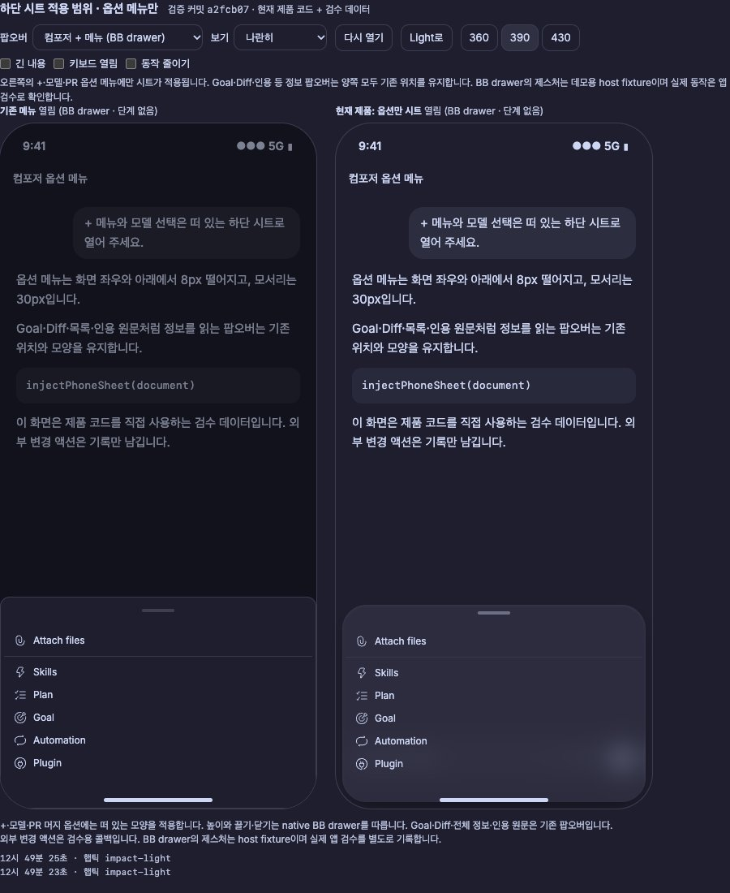
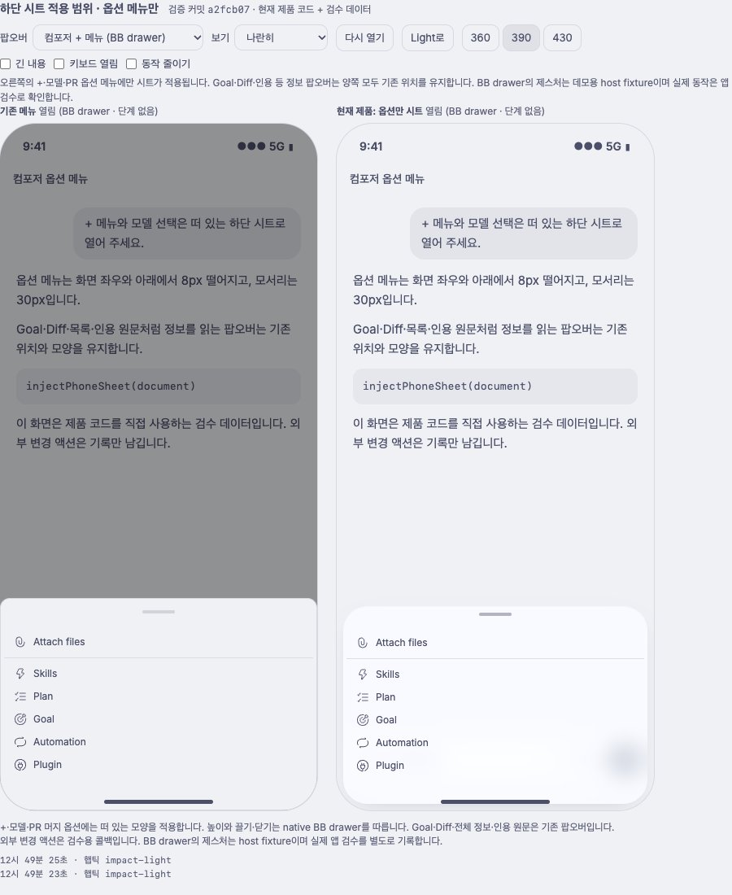

# 떠 있는 옵션 하단 시트

사용자가 선택한 phone 옵션 메뉴의 디자인 레퍼런스다. `+`, 모델 선택, 전송 옵션,
PR 머지 방식처럼 선택지를 고르는 메뉴에 사용한다. 정보 pill 상세·전체 정보 목록·
인용 원문은 이 패턴의 적용 대상이 아니다.

제품 규격은 [컴포저 팝오버 문서](../composer-popovers.md#phone-옵션-메뉴-하단-시트)에,
재사용할 코드는 [phone-sheet.ts](../../lib/phone-sheet.ts)에 둔다. 다른 플러그인에
적용할 때는 먼저 kit의 `docs/design.md`에서 공통 frost·모션·기기 규칙을 읽는다.
이 문서의 크기를 모든 팝오버의 기본값으로 확대하지 않는다.

적용 범위를 확정한 코드 커밋은 `a2fcb07b5dc46f0253c5780ac32137de0d116f79`이다.
아래 이미지는 이 커밋의 제품 코드에 검수 데이터만 넣어 만들었다. 왼쪽은 기존 메뉴,
오른쪽은 떠 있는 옵션 시트다. 실제 사용자 대화와 앱 상태는 담지 않았다.

## 모양

화면 바닥에 붙은 판 대신 세 면이 떨어진 둥근 시트다. 배경을 어둡게 덮지 않고,
frost 표면과 손잡이로 메뉴의 경계를 드러낸다. 내부 항목의 검색·선택·키보드 동작은 유지한다.

| 항목 | 기준 |
|---|---|
| 좌우·아래 여백 | 8px |
| 네 모서리 | 30px |
| 손잡이 | 40×4px, 위 간격 8px, 손잡이 줄 24px |
| 표면 | 테마의 카드 frost 한 겹 |
| 뒤 배경 | 투명, 추가 dim 없음 |
| 본문 높이 | 내용과 native 메뉴의 상한을 따름 |
| 기기 구분 | `device === "phone"`, 창 너비로 판정하지 않음 |

크기는 iPhone 3x 참고 이미지에서 측정했다. 이미지의 좌우 약 23px·아래 25px는
CSS 8px로, 약 90px 모서리는 30px로, 120×12px 손잡이는 40×4px로 옮겼다.

frost는 `info-card.ts`와 `glass-surface.ts`의 테마 값을 공유한다. 라이트·다크 각각
기존 표면·가장자리·그림자 토큰을 쓰며 고정 색을 새로 만들지 않는다. 모델 목록의 제목은
목록이 실제로 밑을 지나갈 때만 별도 frost를 사용한다.

## 현재 제품에서의 연결

`injectPhoneSheet(document)`는 phone에만 CSS를 설치한다. BB의 컴포저 옵션 drawer와
명시적인 모델·PR 메뉴 표식에 연결하고, 메뉴 DOM이나 native 이벤트를 교체하지 않는다.
desktop으로 바뀌거나 플러그인을 해제하면 CSS를 제거한다.

BB가 소유한 drawer는 높이·스크롤·아래로 끌어 닫기·밖 누르기·Esc를 계속 처리한다.
키보드가 열릴 때 BB가 쓰는 inline `bottom`을 보존하고, 별도 `translate`로 아래 8px를 띄운다.
safe-area padding에는 아래 여백을 제외한 나머지를 남긴다.

현재 옵션 drawer에는 위로 끌어 펼치는 두 번째 단계를 붙이지 않는다. native 닫힘 전환이
시작될 때 아래 여백 8px가 한 번 바뀌는 제약이 있다. 이 디자인 레퍼런스가 BB 앱을
수정하거나 native 제스처를 가로채도 된다는 뜻은 아니다.

## 독립 시트의 접힘·펼침 레퍼런스

메뉴 높이와 제스처를 직접 소유할 수 있는 화면을 위해, 사용자가 좋아한 두 단계 시트도
`attachSheet`, `phoneSheetCss`, `sheetLayout`과 회귀 테스트로 보존한다. 실제 정보 팝오버에
자동으로 붙이지 않고, 레퍼런스 데모에서 명시적으로 연결한다.

| 단계 | 기준 |
|---|---|
| 접힘 | 좌우·아래 8px, 모서리 30px, 내용만큼 높이, 상한 416px |
| 펼침 | 양옆에 붙음, 위 두 모서리 30px, 스레드 창 위쪽에서 8px 아래 |
| 끌기 | 손잡이에서 항상 가능, 접힌 본문에서도 가능 |
| 펼친 본문 | 스크롤 유지, 맨 위에서 아래로 끌면 시트 이동 |
| 닫기 | 높이의 25%를 넘기거나 빠르게 아래로 끌기 |
| 모션 | 열기·단계 맞춤 320ms `EASE.out`, 닫기 260ms `EASE.exit` |
| 동작 줄이기 | 전환 즉시 적용 |
| 햅틱 | 단계 변경·끌어 닫기에 `impact-light`, capability가 있을 때만 |

독립 시트는 `container-type`·transform 등의 containing block을 고려해야 한다. 끌기 시작 때
현재 좌표를 다시 읽어, 페이지를 내린 뒤에도 드래그가 맞게 동작한다. iOS가 끌기를
본문 스크롤로 가져가지 않게 손잡이의 첫 터치와 접힌 본문의 첫 이동을 처리한다.

최초 구현과 드래그 좌표 수정은 `2d796314e68b5d43aac80e2debd3e812f5079e1b`에 있다.
`git show 2d79631:lib/phone-sheet.ts`로 당시 구현을 다시 볼 수 있다. 사용자 대화·로컬 세션·
생성 번들은 이 레퍼런스에 복사하지 않는다.

## 다시 적용할 때 확인할 것

- 옵션 메뉴인지 정보 내용 팝오버인지 먼저 구분한다.
- 짧은 메뉴·검색·긴 목록·키보드·safe-area를 확인한다.
- 같은 제품 코드로 데이터를 주입한 데모를 만들고 light·dark를 확인한다.
- 실제 phone과 desktop을 따로 확인한다. Chromium 에뮬레이션을 iPhone 실기 검증으로 부르지 않는다.
- 구현 커밋·실행 번들 일치·캡처·미확인 항목을 기록하고, 최종 화면은 사용자가 판정한다.
