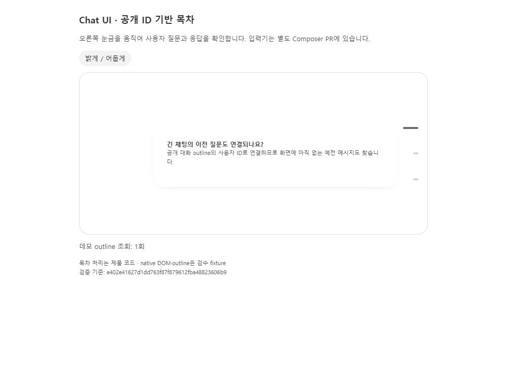
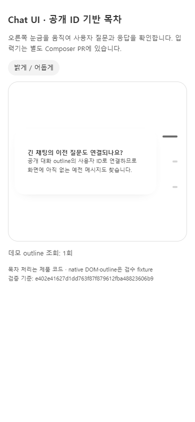
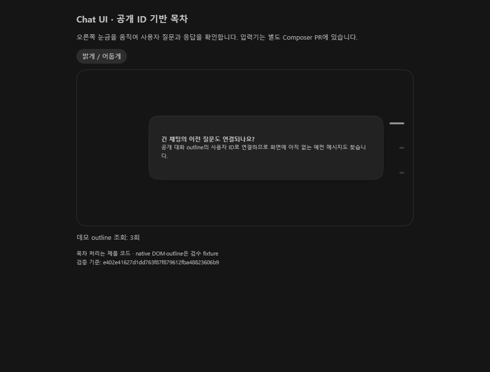
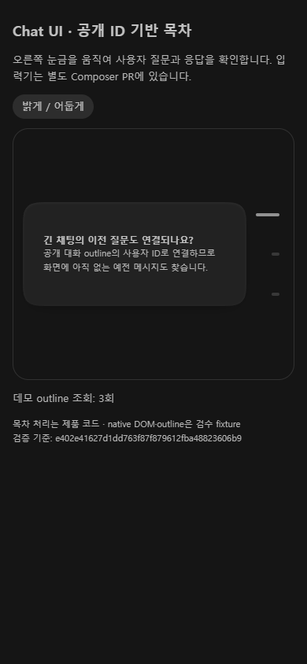

# 2026-11-09 검수 기록

검증한 코드: `e402e41627d1dd763f87f879612fba48823606b9`. 캡처 추가 커밋은 제품 코드를 바꾸지 않는다.

공개 outline의 사용자 ID 연결과 요청 공유·닫을 때 해제, 원격 main의 TOC 수정과 포인터 프레임 병합 및 스쿼클을 실제 제품 코드로 검사했다. 전체 759개와 TOC 28개 검사 및 타입·빌드가 통과했다. 독립 입력 엔진과 등록·의존성은 이 PR에 넣지 않는다.

캡처는 합성 데이터가 주입된 제품 코드의 Chrome 검수다. phone은 모바일 입력 특성의 브라우저 문맥 또는 좁은 화면 fixture이며 실제 휴대폰 캡처가 아니다. 실제 IME·마이크·업로드·외부 전송과 최종 BB 실화면은 별도 검수 대상이다. 자세한 수치와 범위는 [validation.json](validation.json)을 본다.
